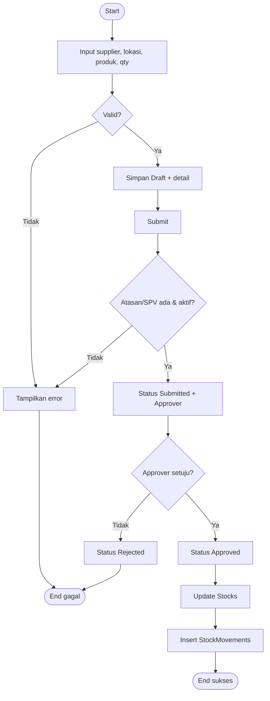
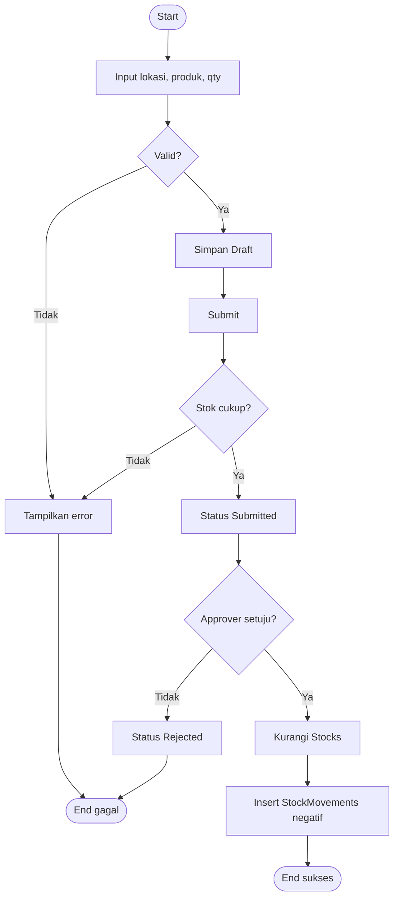
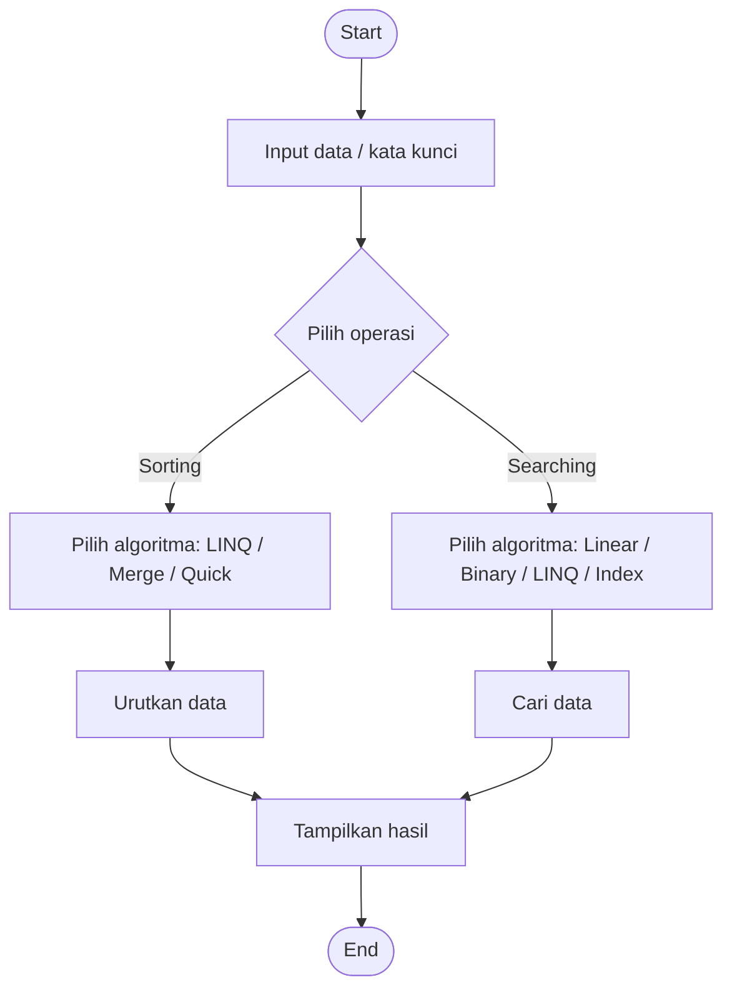

# 02 - Alur Logika (Flowchart)

## 2.1 Metode yang Dipilih

Metode: **flowchart standar** dengan simbol:

| Simbol | Komponen |
|---|---|
| Oval | Start / End |
| Persegi panjang | Process |
| Jajar genjang | Input / Output |
| Belah ketupat | Decision |
| Panah | Alur |
| Lingkaran kecil | Connector |

Flowchart dibuat untuk alur yang paling penting di aplikasi:

1. Stock In → Submit → Approval → Update stok.
2. Stock Out → validasi stok → Approval → Update stok.
3. Sorting/Searching data produk.

## 2.2 Komponen yang Dibutuhkan

| Komponen | Contoh di aplikasi |
|---|---|
| Input | user, supplier, lokasi, produk, quantity |
| Process | validasi, simpan draft, submit, approve, ledger |
| Decision | stok cukup? approver valid? parent ada? |
| Output | dokumen berhasil, pesan validasi, status |
| Data store | `StockInHeaders`, `Stocks`, `StockMovements` |

## 2.3 Relasi Antar Komponen

- Input menghasilkan Draft.
- Submit memerlukan atasan (parent user).
- Approve memerlukan approver yang sesuai.
- Approve memicu `StockLedger` yang mengubah `Stocks` dan `StockMovements`.
- Reject mengubah status tanpa mutasi stok.

## 2.4 Alur Mulai dan Selesai

- Setiap alur dimulai dari **Start** (user membuka form).
- Setiap alur berakhir di **End** (sukses/gagal).
- Alur gagal tetap memiliki end (pesan error).

---

## Flowchart 1 - Stock In Approval

### Langkah

1. User mengisi form.
2. Service memvalidasi supplier, lokasi, produk, quantity.
3. Dokumen disimpan sebagai Draft.
4. Submit mencari atasan; jika tidak ada/non-aktif → gagal.
5. Approver menyetujui/menolak.
6. Jika approve, ledger mengubah saldo dan mencatat movement.

---

## Flowchart 2 - Stock Out

### Catatan

- Pengecekan stok dilakukan saat submit **dan** approve.
- Jika saldo berubah di antara submit dan approve, approve dapat gagal.

---

## Flowchart 3 - Sorting dan Searching

### Catatan

- Sorting: `OrderBy` LINQ atau algoritma manual.
- Searching: linear/binary di memori, atau query index di database.
- Binary search hanya untuk data terurut.

---

## Ringkasan Komponen

| Alur | Decision utama | Efek samping |
|---|---|---|
| Stock In | validasi, atasan, approve | stok bertambah |
| Stock Out | validasi, stok cukup, approve | stok berkurang |
| Sorting/Searching | pilih algoritma, data terurut? | tidak ada (read-only) |
