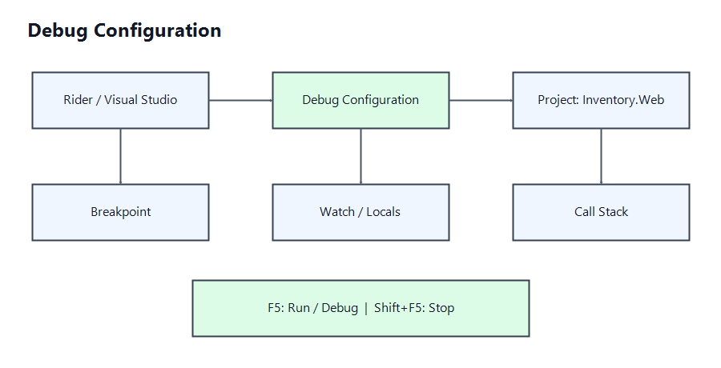

# 02 - Debugging Tools

## 1. Tools

| Tool | Fungsi |
|---|---|
| Rider / Visual Studio | Breakpoint, watch, call stack, debug console |
| `dotnet build` | Kompilasi & melihat error/warning |
| `dotnet test` | Menjalankan unit test |
| `dotnet run` | Menjalankan aplikasi |
| EF Core logging | Melihat query SQL |
| Browser DevTools | Melihat request/response UI |
| DBeaver | Verifikasi data PostgreSQL |
| `dotnet docfx` | Generate dokumentasi API |

## 2. Konfigurasi Debug



Langkah:

1. Buka solution di Rider/Visual Studio.
2. Pilih konfigurasi **Debug** dan project `Inventory.Web`.
3. Pastikan environment `Development`.
4. Pasang breakpoint pada method yang dicurigai.
5. Jalankan debug (F5).
6. Gunakan **Step Into/Over/Out**, **Watch**, **Call Stack**, dan **Locals**.

## 3. Debugging via CLI

```powershell
dotnet run --project src/Inventory.Web
```

Untuk melihat detail:

```powershell
dotnet build Inventory.sln -v normal
dotnet test Inventory.sln -v normal
```

## 4. Logging

- ASP.NET Core menggunakan `ILogger`.
- EF Core dapat diaktifkan untuk melihat query:

```csharp
optionsBuilder
    .UseNpgsql(connection)
    .LogTo(Console.WriteLine, LogLevel.Information)
    .EnableSensitiveDataLogging(builder.Environment.IsDevelopment());
```

`EnableSensitiveDataLogging` hanya untuk development.

## 5. Debugging Database

```sql
SELECT * FROM "v_stock_balance" ORDER BY "Sku";
SELECT * FROM "v_pending_approvals";
SELECT * FROM "StockMovements" ORDER BY "CreatedAt" DESC LIMIT 20;
```

## 6. KUK 1.2 — Mengatasi Kendala

| Kendala | Cara Mengatasi |
|---|---|
| File `.dll` terkunci | Stop IIS Express/JetBrains Debugger, lalu build ulang |
| Razor merah di IDE | Invalidate caches / rebuild; verifikasi `dotnet build` |
| Database tidak connect | Cek service PostgreSQL, connection string, firewall |
| Migrasi gagal | Cek schema, backup, jalankan script manual |
| Test gagal | Baca stack trace, isolasi modul, perbaiki, ulangi |
