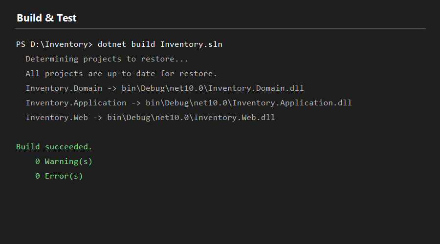

# 03 - Kompilasi dan Analisis Build

## 1. Menu/Komponen Debug

| IDE | Menu |
|---|---|
| Rider | Build → Build Solution / Rebuild Solution |
| Visual Studio | Build → Build Solution / Rebuild Solution |
| CLI | `dotnet build`, `dotnet rebuild` |

## 2. Perintah Kompilasi

```powershell
dotnet restore
dotnet build Inventory.sln -c Debug
dotnet build Inventory.sln -c Release
```

Force rebuild:

```powershell
dotnet clean Inventory.sln
dotnet build Inventory.sln
```

## 3. Ilustrasi Output Build



Contoh output:

```text
Build succeeded.
    0 Warning(s)
    0 Error(s)
```

## 4. Kriteria Kode Lolos Build

| Kriteria | Status |
|---|---|
| Semua project berhasil dikompilasi | Wajib |
| 0 error | Wajib |
| Warning terkendali/tidak kritis | Wajib |
| Razor view terkompilasi | Wajib |
| XML documentation file terbentuk | Wajib |
| Project reference valid | Wajib |
| Migration project ikut build | Wajib |

## 5. Analisis Build

### Build sukses
- Compiler tidak menemukan error sintaks/tipe.
- Semua dependency/package ter-restore.
- Semua project reference valid.

### Build gagal
Penyebab umum:

| Gejala | Penyebab | Solusi |
|---|---|---|
| `MSB3021/MSB3027` | DLL terkunci proses debug | Stop IIS Express/Debugger |
| `CS0246` | Namespace/package hilang | Perbaiki using/reference |
| `CS1061` | Properti/method tidak ada | Sesuaikan API |
| Razor error | View/model tidak cocok | Perbaiki `_ViewImports`/model |
| Restore gagal | Package/network | Cek NuGet/network |

## 6. Catatan Kasus Nyata

Pada pengembangan ini, build pernah gagal karena:

```text
Could not copy ... Inventory.Web.dll
The process cannot access the file because it is being used by
IIS Express Worker Process / JetBrains.Debugger.Worker
```

Ini **bukan error kode**, melainkan file lock. Solusi: hentikan proses debug,
lalu build ulang.

## 7. Verifikasi

```powershell
dotnet build Inventory.sln -c Debug
dotnet build Inventory.sln -c Release
```

Keduanya harus menghasilkan **0 error**.
