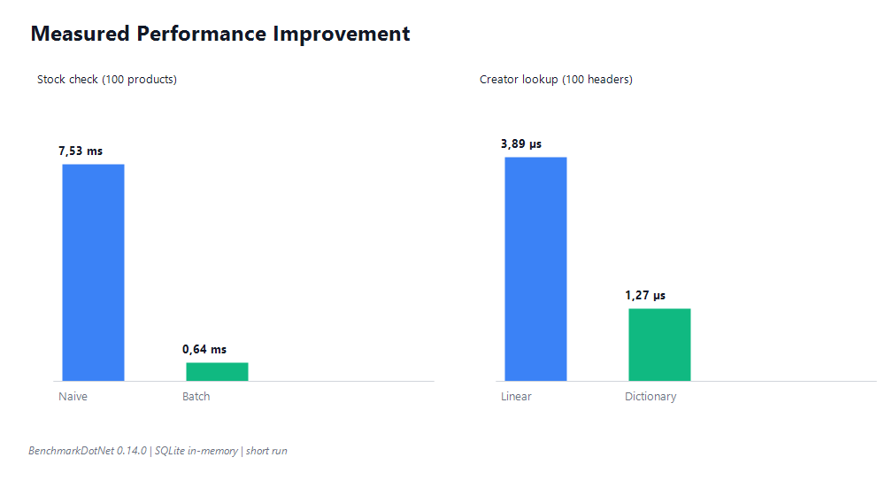

# 07 - Peningkatan Performa

## 1. Hasil Terukur (Prototype)

| Skenario | Baseline | Setelah (batch) | Peningkatan |
|---|---:|---:|---|
| Stock check 100 produk | 7,53 ms / 1.158 KB | **0,64 ms / 173 KB** | **11,8× lebih cepat; 6,7× hemat memori** |
| Creator lookup 100 header | 3,89 µs / 8,59 KB | **1,27 µs / 3,05 KB** | **3,1× lebih cepat; 2,8× hemat memori** |

Sumber: `measurements/baseline.csv`, `measurements/after-optimization.csv`.

## 2. Estimasi Perbaikan (Desain)

| Skenario | Baseline | Target desain | Dasar |
|---|---:|---:|---|
| Ledger 100 changes | 237,4 ms / 40,3 MB | ~50 ms / ~10 MB | Batch stock + one save |
| Approval 100 pending | 15,3 ms / 1,28 MB | ~3 ms / ~0,5 MB | Batch creator lookup |
| Stock card 10k movement | 30,7 ms / 5,22 MB | ~5 ms / ~0,5 MB | Pagination |
| Auth per request | 1 query | ~1 query/60s | Cache |

Angka target adalah **estimasi**, bukan hasil produksi; perlu divalidasi dengan
PostgreSQL dan data nyata.

## 3. Analisis Peningkatan

### Stock check
- Baseline: 100 query, 1,16 MB.
- Batch: 1 query, 173 KB.
- Pengurangan round-trip 100× adalah faktor utama, bukan optimasi CPU.

### Creator lookup
- Linear search O(n) → dictionary O(1).
- Pada 100 item: 3,1×; pada 1.000 item selisih akan lebih besar.

### Ledger
- Perubahan terbesar berasal dari menghilangkan query per change dan
  `SaveChanges` per nomor.
- Target 4–5× realistis; dapat lebih tinggi pada PostgreSQL dengan latency
  jaringan.

### Stock card
- Pagination mengubah memori O(m) menjadi O(pageSize).
- Waktu bergantung pada index `(ProductId, CreatedAt)`.

## 4. Grafik

## 5. Metrik Keberhasilan

| Metrik | Target |
|---|---|
| Query per transaksi 100 baris | ≤ 5 |
| Approval 100 pending | ≤ 5 query |
| Memori stock card | ≤ 1 MB |
| p95 approval | < 500 ms |
| p95 laporan | < 2 detik |

## 6. Catatan

- Prototype batch diukur pada SQLite in-memory.
- Produksi perlu diuji dengan PostgreSQL, index nyata, dan concurrency.
- Perbaikan harus disertai regression test (171 test saat ini).
