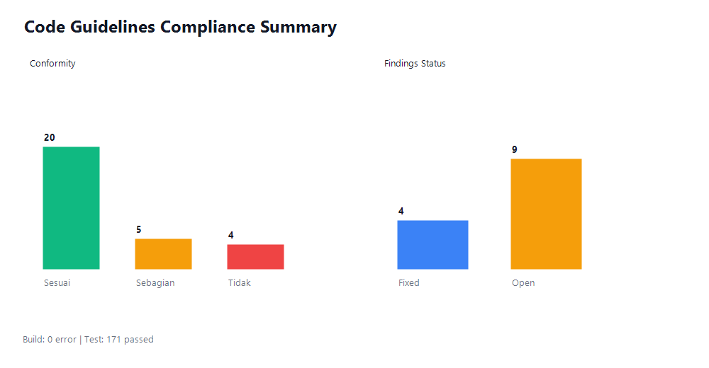

# 00 - Ringkasan



## Hasil Evaluasi

| Aspek | Status |
|---|---|
| Arsitektur layer | Sesuai |
| Penamaan & struktur | Sebagian sesuai |
| Async/await & cancellation | Sesuai |
| Validasi & exception | Sesuai dengan beberapa duplikasi |
| Keamanan kredensial | Belum sesuai (appsettings lokal) |
| Dokumentasi public API | Sebagian |
| Performa query | Belum optimal |
| Tooling/style | Diperbaiki dengan `.editorconfig` |

## Perbaikan yang Diterapkan

| ID | Perbaikan | Status |
|---|---|---|
| FIX-01 | Hapus `Class1.cs` di 3 project | Selesai |
| FIX-02 | Pisahkan `ApprovalGuard` dari `StockLedger.cs` | Selesai |
| FIX-03 | Tambah `.editorconfig` | Selesai |
| FIX-04 | Build ulang & test regresi | Selesai |

## Verifikasi

```text
dotnet build Inventory.sln -> 0 error
dotnet test Inventory.sln  -> 171 passed
```

## Temuan yang Masih Terbuka

- Magic string role/prefix dokumen.
- Duplikasi clamp pagination.
- N+1 approval dan query stok per baris.
- Stock card tanpa pagination.
- Sebagian public API belum XML comments.
- Kredensial di `appsettings.json`.
- `AppControllerBase` masih memakai EF exception (transisi).

## Kesimpulan

Kode sudah mengikuti sebagian besar praktik baik. Perbaikan aman sudah
diterapkan, sedangkan refactor besar (constants, batch query, XML comments)
direncanakan tanpa mengubah spesifikasi.
