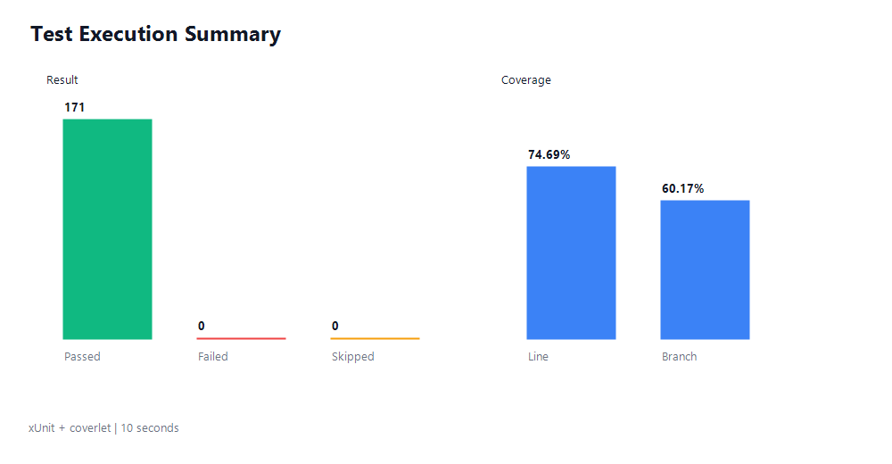

# 00 - Ringkasan

## Hasil

| Metrik | Nilai |
|---|---:|
| Framework | xUnit + FluentAssertions |
| Database uji | SQLite in-memory |
| Total test | 171 |
| Passed | 171 |
| Failed | 0 |
| Skipped | 0 |
| Durasi | ±10 detik |
| Line coverage | **74.69%** (2530/3387) |
| Branch coverage | **60.17%** (550/914) |

## Cakupan

- Guard & validation
- Stock ledger & transaksi (In/Out/Transfer/Adjustment/Opname)
- Approval & authorization
- Catalog, supplier, location
- Report, audit, document number
- User & Identity

## Temuan

1. Semua 171 test lulus.
2. Coverage line 74.69%, branch 60.17%.
3. Gap: integration test PostgreSQL, API test, UI automation, performance.
4. Test data terisolasi dengan SQLite in-memory.
5. Belum ada CI pipeline yang menjalankan test otomatis.

## Rekomendasi

| Prioritas | Rekomendasi |
|---|---|
| Tinggi | Integration test PostgreSQL |
| Tinggi | API/contract test |
| Sedang | Coverage gate di CI |
| Sedang | Test untuk ReportService/stock card pagination |
| Rendah | UI smoke test |

## Kesimpulan

Kualitas unit test baik (semua lulus) dan coverage memadai untuk logika inti.
Perlu penambahan integration/performance test sebelum produksi.
