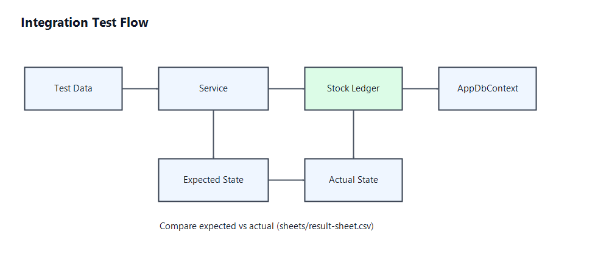

# 00 - Ringkasan

## Hasil Pengujian

| Metrik | Nilai |
|---|---:|
| Modul diuji | 10 skenario integrasi |
| Test suite | 171 test |
| Passed | 171 |
| Failed | 0 |
| Skipped | 0 |
| Build | 0 error |
| Line coverage | 74.69% |
| Branch coverage | 60.17% |
| Durasi test | ±7 detik |

## Cakupan Integrasi

1. Stock In → approval → ledger → stok.
2. Stock Out → validasi stok → ledger.
3. Transfer → dua saldo + dua movement.
4. Adjustment → difference → stok.
5. Opname → counted → stok.
6. Approval authorization.
7. Admin auto-approve.
8. Soft delete + query filter.
9. Audit log.

## Peralatan Utama

- .NET SDK 10.0.404
- xUnit 2.9.3
- FluentAssertions 8.11.0
- EF Core SQLite in-memory 10.0.15
- coverlet.collector 10.1.0
- Rider/Visual Studio
- DBeaver

## Status

- Semua skenario INT-01–INT-10 **Pass** pada level integrasi modul (in-memory).
- Gap: PostgreSQL nyata, API/controller, UI.

## Rekomendasi

| Prioritas | Rekomendasi |
|---|---|
| Tinggi | Integration test PostgreSQL |
| Tinggi | API test dengan WebApplicationFactory |
| Sedang | UI smoke test |
| Sedang | CI otomatis |
